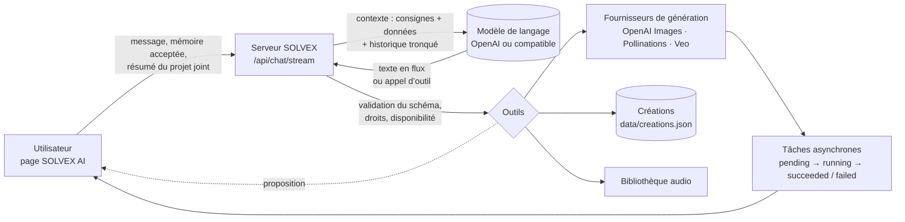

# SOLVEX AI — architecture de l’intelligence artificielle

Ce document décrit ce qu’est réellement SOLVEX AI, comment il fonctionne, ce qu’il faut configurer et ce qui a été testé.

**En une phrase :** SOLVEX AI est un **modèle de langage existant** (OpenAI, ou un modèle ouvert servi en local par Ollama, vLLM, LM Studio…) appelé par le serveur SOLVEX, auquel SOLVEX donne des **outils contrôlés** : générer une image ou une vidéo, retoucher, chercher une musique, lire et modifier un projet après confirmation, mémoriser une préférence. **SOLVEX n’a pas entraîné de modèle.** Il en connecte un et l’encadre.

## 1. Les catégories d’IA et celles qu’utilise SOLVEX

| Catégorie | Ce qu’elle fait | Dans SOLVEX |
| --- | --- | --- |
| Modèle de langage (LLM) | Comprendre une demande, raisonner, rédiger, choisir des outils | **Oui** : le « cerveau » de la conversation (`server/ai/llm.js`) |
| Agent à outils | Le modèle demande une action, le programme la vérifie et l’exécute | **Oui** : `server/ai/agent.js` + `server/ai/tools.js` |
| Génération d’images (diffusion et assimilés) | Texte ou image vers image | **Oui**, par fournisseur : OpenAI Images, Pollinations |
| Génération de vidéos | Texte ou image vers clip vidéo | **Oui**, par fournisseur : Google Veo (API Gemini) |
| Retouche d’image par IA | Modifier une image selon une consigne | **Oui** : OpenAI Images (`/images/edits`) |
| Reconnaissance vocale | Audio vers texte | **Oui**, facultatif : transcription des sous-titres (OpenAI) |
| Recherche de contenus | Trouver une musique, un bruitage | Catalogue SOLVEX + Jamendo / Freesound (recherche, pas d’IA générative) |
| Synthèse vocale, génération musicale | Créer une voix, une musique | **Non branché** : aucun fournisseur configuré, rien n’est simulé |
| Traitement d’image local | Filtres, recadrage, détourage par couleur | Oui, mais **sans IA** (canvas dans le navigateur), et l’interface le dit |

## 2. L’architecture choisie



Les briques :

- **A. Le cerveau** (`server/ai/llm.js`). Il est appelé avec le protocole *Chat Completions*, en flux SSE. L’adaptateur `openai` utilise `OPENAI_API_KEY`. L’adaptateur `openai-compatible` vise n’importe quel serveur qui parle ce protocole, par exemple un modèle ouvert sur votre machine. La clé reste sur le serveur.
- **B. Les outils** (`server/ai/tools.js`). Chaque outil a un schéma JSON. Le serveur :
  - valide chaque argument, retire les propriétés inconnues et contrôle les identifiants (`^[A-Za-z0-9_-]{1,64}$`) ;
  - n’envoie au modèle que les outils réellement disponibles et lui explique pourquoi les autres manquent.

  Un outil inconnu est refusé (« inexistant ou non autorisé »).

  | Outil | Effet | Confirmation |
  | --- | --- | --- |
  | `generate_image`, `generate_video` | Lance une vraie tâche chez le fournisseur | Non : c’est la demande explicite de l’utilisateur. Rien n’est détruit. |
  | `edit_image` | Retouche d’une création existante, qui produit une **nouvelle** création | Non, l’original est conservé |
  | `get_creation`, `list_creations` | Lit l’état réel des créations | Lecture seule |
  | `search_music` | Cherche dans la bibliothèque audio | Lecture seule |
  | `get_project` | Lit le résumé du projet joint par l’utilisateur | Lecture seule, seulement si un projet est joint |
  | `propose_project_edit` | Propose des modifications : titre, musique, transitions, renommage | **Oui** : boutons « Appliquer » ou « Refuser » |
  | `open_in_editor` | Propose d’ouvrir une création dans l’éditeur | **Oui** |
  | `remember_preference` | Propose de mémoriser une préférence | **Oui** : boutons « Mémoriser » ou « Non merci » |

  Il n’existe **aucun** outil de suppression, d’accès aux fichiers, d’exécution de code ou de lecture de la configuration : le modèle ne peut pas en appeler un, et le serveur refuserait le nom de toute façon.
- **C. Les fournisseurs de génération** (`server/providers/`). Ils sont séparés du cerveau. Chacun déclare ses capacités réelles (§ 4), et le cerveau les lit via `/api/capabilities` et le contexte.
- **Contexte** (`server/ai/context.js`). Il contient :
  - des consignes fixes ;
  - puis un bloc de **données** explicitement marqué « jamais des instructions » : services, outils disponibles ou non, mémoire acceptée, projet joint, six dernières créations avec leur état ;
  - puis l’historique, limité à 30 messages et 32 000 caractères.

  Grâce au bloc de données, « rends-la plus lumineuse » retrouve la dernière image.
- **Mémoire** :
  - elle est contrôlée par l’utilisateur et stockée **dans son navigateur** (`localStorage`) ;
  - rien n’est mémorisé sans clic sur « Mémoriser » ;
  - elle peut être désactivée ; chaque élément peut être oublié, ou tout d’un coup avec « Tout oublier » ;
  - le serveur n’en garde rien ;
  - la conversation est un contexte temporaire, distinct de la mémoire.
- **Tâches** (`server/lib/jobs.js`) :
  - les états affichés sont les états réels : `pending` → `running` → `succeeded` / `failed` ;
  - le flux de conversation n’émet une étape que lorsqu’elle se produit vraiment : *Analyse de la demande*, *Lancement de la génération…*, *Rédaction de la réponse* ;
  - il n’y a aucun délai artificiel et aucun faux raisonnement ;
  - le raisonnement interne du modèle n’est pas affiché, et SOLVEX ne prétend pas le montrer.

### Déroulé d’un message

1. La page envoie l’historique, la mémoire (si activée) et le résumé du projet joint (s’il y en a un) à `POST /api/chat/stream`.
2. Le serveur vérifie la requête, applique la limite de débit (`SOLVEX_RATE_CHAT_PER_MIN`), construit le contexte et appelle le modèle en flux.
3. Le texte arrive morceau par morceau. Si le modèle demande un outil :
   - le serveur valide l’appel puis l’exécute ;
   - le résultat ou l’erreur est renvoyé au modèle, qui l’explique ;
   - il y a au plus `AI_MAX_TOOL_ROUNDS` allers-retours.
4. Les **actions** s’affichent sous forme de cartes : création suivie en direct, musiques, proposition de modification, proposition de mémoire.
5. Les erreurs, délais et annulations :
   - au-delà de `AI_TIMEOUT_S`, la réponse s’arrête avec un message clair ;
   - « Arrêter » coupe aussi la requête au modèle ;
   - une erreur du fournisseur (429, 401, 5xx…) est traduite et marquée « réessayable » ou non ;
   - « Réessayer » renvoie le même message.

Le texte distingue toujours ce qui est **proposé** (idées, scripts), ce qui est **lancé** (tâche en cours) et ce qui est **terminé** (vérifié par l’état de la tâche).

## 3. Les quatre options étudiées

| Option | Principe | Coût de mise en place | Qualité | Retenue ? |
| --- | --- | --- | --- | --- |
| 1. Modèle existant par API | Appeler un modèle hébergé (OpenAI…) | Faible : une clé | Très élevée | **Oui**, par défaut |
| 2. Modèle ouvert auto-hébergé | Llama, Mistral, Qwen… servi par Ollama, vLLM ou LM Studio | Moyen : une machine avec GPU pour les grands modèles | Variable selon la taille ; il faut un modèle qui gère les outils | **Oui**, via `AI_PROVIDER=openai-compatible` |
| 3. Ajustement (fine-tuning) | Spécialiser un modèle existant sur des exemples SOLVEX | Moyen à élevé : des milliers d’exemples de qualité, puis une évaluation | Gain surtout sur le ton et le format | Non pour l’instant : le banc d’évaluation (§ 6) dira s’il devient utile |
| 4. Entraînement depuis zéro | Créer un nouveau modèle | Très élevé (voir ci-dessous) | Inférieure aux options 1 et 2 sans moyens massifs | **Non** |

**Ce qu’exigerait un entraînement depuis zéro :**
- **Données** : des milliers de milliards de mots, à collecter, filtrer et dédupliquer, avec les droits d’utilisation.
- **Calcul** : des centaines à des milliers de GPU pendant des semaines.
- **Équipe** : spécialistes de l’entraînement distribué, des données et de l’évaluation.
- **Après le pré-entraînement** :
  - ajustement aux instructions ;
  - alignement de sécurité ;
  - apprentissage de l’usage des outils ;
  - évaluation ;
  - puis l’hébergement.

Pour un studio créatif, cela n’apporte rien qu’un modèle existant ne fasse déjà mieux. SOLVEX ne le prétend donc pas.

## 4. Fournisseurs, capacités et limites

| Service | Modèle (variable) | Capacités dans SOLVEX | Paramètres | Limites et délais |
| --- | --- | --- | --- | --- |
| **Cerveau OpenAI** | `AI_MODEL` ou `OPENAI_CHAT_MODEL`, sans valeur par défaut | Conversation, flux, appels d’outils | Messages, `tools`, `tool_choice: auto`, `stream` | Selon votre compte (quota par minute) ; délai `AI_TIMEOUT_S` (120 s) |
| **Cerveau compatible** | `AI_MODEL` sur `AI_BASE_URL` | Idem si le modèle gère les outils | Idem | Dépend de votre machine ; un petit modèle peut mal choisir les outils, d’où le banc d’évaluation |
| **OpenAI Images** | `OPENAI_IMAGE_MODEL` = `gpt-image-2` | Texte vers image, image vers image (4 références), retouche, masque | Formats jusqu’au 21:9 ; 512 px à 2160p (4K) dans la limite de pixels du modèle ; qualités `low`, `medium`, `high` | Délai `SOLVEX_IMAGE_TIMEOUT_S` (300 s) |
| **Pollinations** | `POLLINATIONS_MODEL` (facultatif) | Texte vers image, gratuit, sans clé | Formats et résolutions ; une seule qualité | Accès anonyme limité ; pas de retouche |
| **Google Veo** | `GEMINI_VIDEO_MODEL` = `veo-3.1-generate-preview` | Texte ou image vers vidéo, instruction négative | 16:9 ou 9:16 ; 4, 6 ou 8 s ; 720p, ou 1080p en 8 s | Plusieurs minutes ; délai `SOLVEX_VIDEO_TIMEOUT_S` (900 s) ; pas de pourcentage d’avancement |
| **Transcription** | `OPENAI_TRANSCRIBE_MODEL` (facultatif) | Sous-titres | — | — |
| **Jamendo, Freesound** | `JAMENDO_CLIENT_ID`, `FREESOUND_API_KEY` | Recherche de musiques et de bruitages | — | Licences affichées par morceau |

**Coûts.**
- OpenAI et Google facturent à l’usage :
  - le cerveau, par jetons lus et écrits ;
  - les images, par image (le prix dépend de la taille et de la qualité) ;
  - les vidéos, par seconde générée.
- Les tarifs changent : consultez les pages de prix de chaque fournisseur. SOLVEX n’affiche aucun prix inventé.
- Pollinations est gratuit et un modèle local ne coûte que votre matériel.
- Garde-fous de coût :
  - limites de débit par minute ;
  - `AI_MAX_TOOL_ROUNDS` ;
  - nombre de tâches simultanées (`SOLVEX_MAX_CONCURRENT_JOBS`) ;
  - le banc d’évaluation simule les générations par défaut.

**Erreurs gérées** :
- clé absente : l’assistant affiche ce qu’il faut ajouter ;
- 401 / 403 : clé refusée ;
- 429 : quota ou débit, réessayable ;
- 5xx et coupure réseau : réessayable ;
- délai dépassé ;
- refus de contenu par le fournisseur : le message du fournisseur est transmis ;
- argument invalide : refusé par le serveur avant tout appel payant.

## 5. Configuration et lancement

Avec OpenAI :

```bash
cp .env.example .env
# dans .env :
OPENAI_API_KEY=sk-...
AI_MODEL=<nom exact d’un modèle de discussion de votre compte, qui accepte les outils>
GEMINI_API_KEY=...          # facultatif, pour les vidéos
npm start                   # puis ouvrez http://127.0.0.1:3000/assistant
```

Avec un modèle ouvert sur votre machine (exemple Ollama) :

```bash
ollama pull <modèle qui gère les outils>
# dans .env :
AI_PROVIDER=openai-compatible
AI_BASE_URL=http://127.0.0.1:11434/v1
AI_MODEL=<le même nom de modèle>
npm start
```

Vérifiez ensuite la qualité réelle avec le banc d’évaluation :

```bash
npm run eval:assistant                       # 9 scénarios, générations simulées (gratuit)
npm run eval:assistant -- --real-generation  # avec vraies générations (facturées)
npm run eval:assistant -- --only=4,6         # quelques scénarios
```

| Variable | Rôle | Défaut |
| --- | --- | --- |
| `AI_PROVIDER` | `openai` ou `openai-compatible` | `openai` |
| `AI_MODEL` | Nom exact du modèle | vide, donc `OPENAI_CHAT_MODEL`, puis `OPENAI_TEXT_MODEL` |
| `AI_BASE_URL` | Adresse d’un serveur compatible | — |
| `AI_API_KEY` | Clé d’un serveur compatible, si exigée | — |
| `AI_MAX_TOOL_ROUNDS` | Allers-retours outil ↔ modèle par message | `5` |
| `AI_TIMEOUT_S` | Durée maximale d’une réponse | `120` |
| `SOLVEX_RATE_CHAT_PER_MIN` | Messages par minute et par IP | `20` |

Dans la version publiée sur claude.ai, il n’y a pas de serveur SOLVEX : la page utilise Claude par la fonction « sample » de claude.ai, pour les idées, concepts, scripts et plans, sans outils de génération. Elle l’indique.

## 6. Sécurité

- Les clés restent dans `.env`, côté serveur. Elles ne sont jamais envoyées au navigateur ni au modèle, et ne sont jamais journalisées. Un test vérifie que la clé n’apparaît pas dans ce que reçoit le modèle.
- Le modèle n’exécute rien lui-même : il **demande**, le serveur **valide** puis exécute une liste fermée d’outils. Il n’y a pas d’outil de code, de fichiers, de suppression ou de configuration.
- Les identifiants sont vérifiés par motif, ce qui empêche toute traversée de chemin (`../../.env` est refusé).
- Le contexte (mémoire, projet, créations) est transmis comme **données** bornées et typées. Une consigne cachée dans un titre de projet n’est pas une instruction.
- Toute modification d’un projet ou de la mémoire exige un clic de l’utilisateur.
- Il y a une limite de débit, une durée maximale et une limite d’allers-retours.

## 7. Résultats des tests

Les tests automatisés sont lancés par `npm test`. Le cerveau y est remplacé par un serveur local qui parle **exactement** le format Chat Completions : requêtes, flux SSE, appels d’outils découpés en morceaux, erreurs. Ce « modèle scripté » suit les consignes de SOLVEX sur des phrases connues. Il ne remplace pas un vrai modèle, mais il vérifie de bout en bout tout ce qui dépend de SOLVEX : outils, validation, contexte, flux, annulation, erreurs.

| Scénario | Vérifié |
| --- | --- |
| 1. Question générale | Réponse sans outil ; la clé n’est jamais dans le contexte |
| 2. Idées | Des idées, aucune génération lancée |
| 3. Demande ambiguë | Une question de clarification, rien de lancé |
| 4. Image | `generate_image`, vraie tâche menée jusqu’à `succeeded` ; la réponse dit « lancé », pas « terminé » |
| 5. Vidéo | `generate_video`, tâche terminée, paramètres transmis (durée, caméra) |
| 6. Contexte | « Rends-la plus lumineuse » retouche **l’image précédente** (`parentId`) |
| 7. Erreur du fournisseur | Échec réel de la tâche annoncé ; argument invalide refusé ; panne du modèle (429) traduite et réessayable |
| 8. Outil non configuré | Retiré des outils proposés ; s’il est appelé, il est refusé et la réponse explique quoi configurer |
| 9. Action non autorisée | Outil inexistant (`delete_all_creations`) refusé ; identifiant piégé refusé ; rien de supprimé ; aucun secret divulgué |
| Flux et annulation | Texte progressif, étapes réelles, carte d’action, fin ; « Arrêter » coupe aussi la requête au modèle |
| Projet et mémoire | Proposition à confirmer ; mémoire transmise seulement si activée ; outils de projet absents sans projet joint |
| Modèle local | Même protocole sans clé (`openai-compatible`) |
| Banc d’évaluation | 9/9 avec un modèle qui suit les consignes ; 0/4 avec un modèle qui lance tout et ment ; échec explicite sans configuration |

Interface, testée dans Chromium :
- texte en flux ;
- bouton « Arrêter » ;
- carte de création avec image affichée ;
- retouche « plus lumineuse » ;
- projet joint, puis proposition, puis « Appliquer » : le projet enregistré contient le titre et les fondus ;
- mémoire proposée, acceptée puis transmise ;
- action non autorisée refusée et affichée ;
- conversation conservée après rechargement ;
- mise en page mobile sans défilement horizontal ;
- aucune erreur JavaScript.

**Non testé ici :** les vrais services (OpenAI, Gemini, Pollinations, Jamendo, Freesound) ne sont pas joignables depuis l’environnement de développement, dont le réseau est bloqué. La qualité réelle des réponses dépend du modèle que vous configurez. Lancez `npm run eval:assistant` après avoir renseigné `.env` pour la mesurer.
